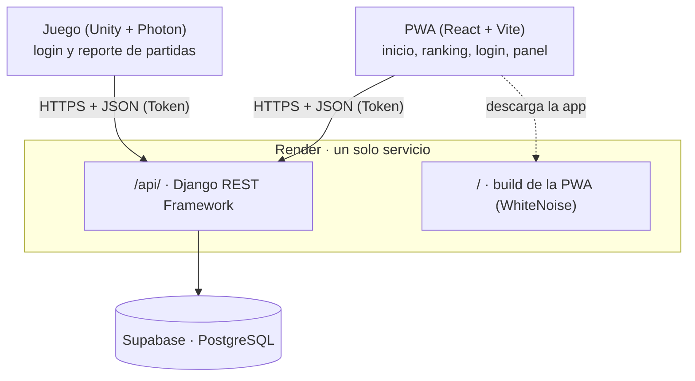
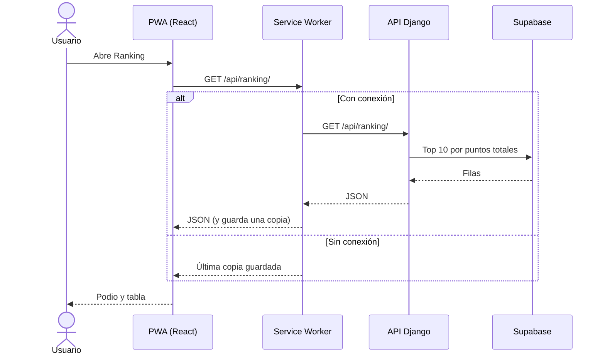
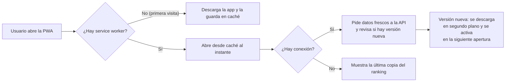
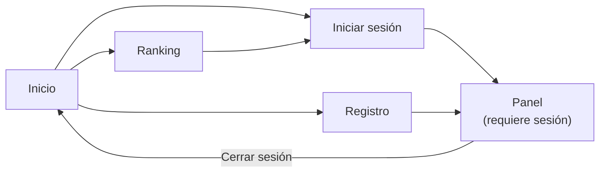
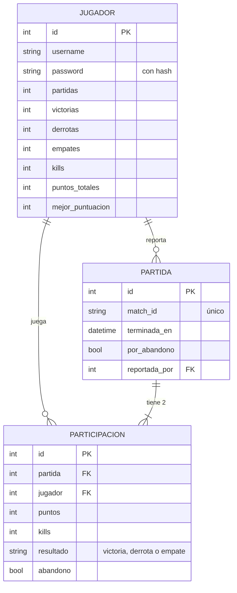
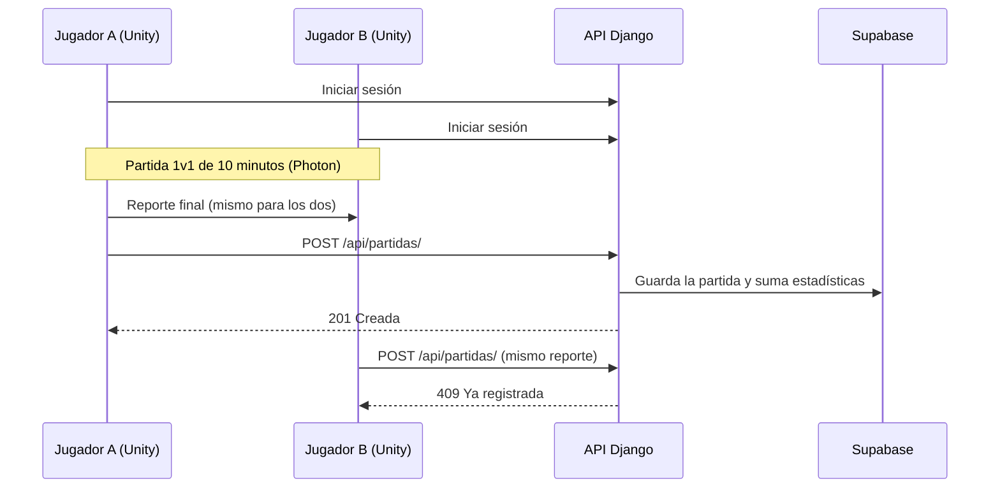

# BEARSTARDS PWA

# Integrantes
    Angel David Arras Orozco
    Angel Guillermo Gonzalez Gomez
    Dylan Munoz Flores
    Guillermo Martinez Delgadillo
    Victor Hugo Baeza Rocha


PWA de **Little Bearstards** (Turbo Studios). Presenta el juego, muestra el ranking de jugadores, permite registrarse e iniciar sesión, y recibe desde el juego (Unity) el resultado de cada partida.

> **Estado:** en desarrollo. Este documento describe la propuesta de arquitectura e interfaz. El backend ya tiene el proyecto Django, los modelos y las tablas creadas en Supabase; faltan los endpoints y el despliegue en Render.

## Documentación por módulo

| Módulo | Qué contiene |
|---|---|
| [**Backend** (`backend/`)](backend/README.md) | Puesta en marcha de Django, base de datos y migraciones, API, comandos del CI, base de datos local con Docker y problemas comunes |
| [**Interfaz** (`ui/`)](ui/README.md) | Puesta en marcha de React + Vite, conexión con el backend en local, estructura, pantallas y reglas para trabajar en el front |
| [**Laboratorio de pruebas**](docs/laboratorio-pruebas/README.md) | Cómo replicar la base de datos con scripts SQL, levantar backend y PWA en local, y las pruebas con sus evidencias |

Planeación general del proyecto: [StingerBlade/planeacion_integradora](https://github.com/StingerBlade/planeacion_integradora).

## Arquitectura

### Diagrama de arquitectura



### Stack

| Capa | Tecnología |
|---|---|
| Front (`ui/`) | React 19 + Vite 8 + `vite-plugin-pwa` + React Router 7 + Tailwind CSS 4 |
| Back (`backend/`) | Django + Django REST Framework |
| Base de datos | PostgreSQL en Supabase (solo como base de datos) |
| Hosting | Render, un Web Service |
| CI/CD | GitHub Actions → Render |
## Consumo de API

La PWA obtiene todos sus datos de la API REST con `fetch` y rutas relativas (`/api/...`), porque front y back comparten dominio.

### Endpoints

| Método y ruta | Sesión | Uso en la PWA |
|---|---|---|
| `POST /api/auth/registro/` | No | Crear cuenta; devuelve el token y el jugador |
| `POST /api/auth/login/` | No | Iniciar sesión; devuelve el token y el jugador |
| `POST /api/auth/logout/` | Sí | Cerrar sesión |
| `GET /api/ranking/` | No | Lista del ranking (top 10 por puntos totales) |
| `GET /api/yo/` | Sí | Estadísticas del jugador para el Panel |
| `GET /api/yo/partidas/` | Sí | Historial de las últimas partidas del jugador (lista y gráfica) |
| `POST /api/partidas/` | Sí | Lo usa el juego al terminar una partida (no la PWA) |

### Cómo se consumen y muestran las listas

- Un solo módulo, `src/api/cliente.js`, hace todas las peticiones y agrega `Authorization: Token <token>` cuando hay sesión.
- El **ranking** y el **historial** se piden al abrir su pantalla y se dibujan a partir del JSON recibido: podio y tabla en Ranking; tabla y gráfica en Panel.
- Cada lista contempla tres estados: **cargando**, **vacía** (por ejemplo, un jugador sin partidas) y **error** (sin conexión o servidor caído).
- Si la API responde `401`, el token ya no sirve: se borra la sesión y se manda al usuario a iniciar sesión.



## Estrategia PWA

### Manifiesto

Lo genera `vite-plugin-pwa` (`manifest.webmanifest`):

| Campo | Valor |
|---|---|
| `name` / `short_name` | Little Bearstards / Bearstards |
| `lang` | `es` |
| `start_url` | `/` |
| `display` | `standalone` (se abre como app, sin barra del navegador) |
| `theme_color` / `background_color` | `#241a55` (`night`) |
| `icons` | 192×192 y 512×512, más una versión `maskable` para Android |

Con el manifiesto, la PWA se puede **instalar** en el celular o la computadora y abre con su propio ícono y pantalla de inicio.

### Service Worker

Lo genera `vite-plugin-pwa` (Workbox), con `registerType: "autoUpdate"`.

| Recurso | Estrategia | Resultado |
|---|---|---|
| HTML, JS, CSS, fuentes, íconos e imágenes de los osos | *Precache* | La app abre completa sin internet |
| Navegación (cualquier ruta) | Respaldo a `index.html` | Nunca aparece la página de error del navegador |
| `GET /api/ranking/` | *NetworkFirst* | Datos frescos con red; sin red, el último ranking visto |
| `/api/auth/*`, `/api/yo/*` | Sin caché | Los datos personales y la sesión nunca quedan guardados |

### Funcionamiento en segundo plano

- El service worker se instala y trabaja **aparte de la página**: atiende las peticiones aunque la app esté cerrada o sin red.
- Cuando se publica una nueva versión, el service worker la **descarga en segundo plano** y la activa sola en la siguiente apertura (`autoUpdate`).
- Cada vez que hay conexión, la copia del ranking se **actualiza en segundo plano**, lista para la próxima vez que no haya internet.



## Diseño de la PWA

### Pantallas

| Ruta | Pantalla | Contenido | ¿Requiere sesión? |
|---|---|---|---|
| `/#/` | Inicio | Portada del juego: premisa, cómo se juega, armas, mapa de la juguetería, galería, adelanto del ranking y equipo | No |
| `/#/ranking` | Ranking | Podio de los 3 primeros, tabla de jugadores por puntos totales, buscador por nombre y la posición del jugador con sesión iniciada | No |
| `/#/login` | Iniciar sesión | Usuario y contraseña | No |
| `/#/registro` | Registro | Usuario y contraseña (mínimo 8 caracteres) | No |
| `/#/panel` | Panel | Estadísticas del jugador, gráfica de puntos de sus últimas 10 partidas e historial de partidas | Sí |

**Datos que muestra cada pantalla**

- **Ranking:** usuario, puntos totales, victorias, derrotas, empates y kills.
- **Panel, estadísticas:** partidas, victorias, derrotas, empates, kills, puntos totales y mejor puntuación.
- **Panel, historial y gráfica:** por partida, la fecha, los puntos, las kills, el resultado (victoria, derrota o empate) y si fue por abandono.

La PWA solo muestra los datos de la sección *Datos que maneja*. No se piden ni se guardan correos, rachas, logros ni rankings por periodo.

- Se usa `HashRouter`: las rutas van después del `#`, así Django solo tiene que servir `index.html`.
- Si alguien entra a `/#/panel` sin sesión, se le manda a iniciar sesión.
### Mapa de navegación



### Sesiones

- El registro y el inicio de sesión devuelven un **token** que identifica al jugador.
- Se usa **el mismo sistema en la PWA y en el juego**: una cuenta creada en un lado sirve en el otro.
- Para jugar en línea es **obligatorio iniciar sesión**.

### Estructura modular

```
ui/src/
├── api/            # cliente.js: todas las llamadas a /api/
├── auth/           # contexto de sesión (token, jugador, login, registro, logout)
├── components/     # piezas reutilizables: Navbar, Footer, Hero, Bear, Icons,
│                   # secciones de Inicio, ProtectedRoute, ui.js (estilos de botones e inputs)
├── pages/          # una pantalla por archivo: Home, Ranking, Login, Register, Panel
├── assets/         # logos e imágenes de los osos
├── index.css       # tokens de diseño (colores, fuentes, sombras, animaciones)
├── App.jsx         # rutas
└── main.jsx        # punto de entrada
```

- **JavaScript modular:** cada pantalla, componente y servicio vive en su propio archivo, y las pantallas solo combinan componentes.
- **CSS modular:** Tailwind CSS 4 con *tokens* en `index.css`. Los estilos repetidos (botones, inputs) se definen una vez en `components/ui.js`.

### Diseño adaptativo

- **Mobile first:** se diseña primero para celular y se amplía con los puntos de quiebre de Tailwind: `sm` (640 px), `md` (768 px) y `lg` (1024 px).
- En pantallas chicas el menú se convierte en un **botón de hamburguesa**.
- Los títulos escalan con el ancho de la pantalla (`clamp`).
- Las tablas y tarjetas se acomodan en una columna en celular y en varias en escritorio.
- El contenido tiene un ancho máximo de entre 1024 y 1280 px, centrado.
- La página nunca genera scroll horizontal.
## Guía de estilos

Estilo **neobrutalismo cartoon**: toma del neobrutalismo los bordes gruesos, las sombras duras sin difuminar y los colores planos y saturados, y los suaviza con esquinas redondeadas, tipografía juguetona y animaciones, ambientado en una juguetería de noche. Los osos se muestran en **low poly**.

### Colores

| Token | Hex | Uso |
|---|---|---|
| `ink` | `#1b1030` | Bordes, sombras, contornos y texto sobre fondos claros |
| `night` | `#241a55` | Fondo principal y color del tema del navegador (`theme-color`) |
| `night-2` | `#34248a` | Fondo de secciones y tarjetas sobre `night` |
| `night-3` | `#46309f` | Tercer nivel de fondo |
| `paper` | `#fffaf0` | Texto principal sobre fondo oscuro y tarjetas claras |
| `cream` | `#fff3d6` | Fondo de secciones claras |
| `sun` | `#ffd23f` | Color principal: botón principal y primer lugar del ranking |
| `pink` | `#ff5fa2` | Acento: botones secundarios y tercer lugar |
| `sky` | `#3ec6ff` | Acento: segundo lugar y contorno de foco del teclado |
| `mint` | `#5be3b0` | Acento: estados positivos y etiquetas |
| `tangerine` | `#ff8a3d` | Acento: resaltados |
| `fur` / `fur-dark` | `#d99a5b` / `#a8652b` | Pelaje de los osos |

- Sobre los colores de acento (`sun`, `pink`, `sky`, `mint`, `tangerine`) el texto siempre va en `ink`.
- Sobre `night` el texto va en `paper`.
- Las secciones de la página de inicio alternan fondo oscuro (`night`) y claro (`cream`).
- La paleta es independiente de los colores del logo de Turbo Studios.

### Tipografía

| Uso | Fuente | Detalles |
|---|---|---|
| Títulos (`h1`–`h4`) y botones | **Lilita One** | Peso 400, interlineado 1.05 |
| Texto | **Fredoka** (variable) | 17 px, interlineado 1.6 |

- Las dos fuentes se instalan con npm (`@fontsource`), así que funcionan sin conexión.
- Los títulos grandes llevan contorno y sombra oscura (`text-outline`).
- Números con formato de México (`1,250`).

### Bordes y sombras

| Clase | Borde | Sombra |
|---|---|---|
| `toon-sm` | 3 px `ink` | 3 px 3 px dura |
| `toon` | 3 px `ink` | 5 px 5 px dura |
| `toon-lg` | 4 px `ink` | 8 px 8 px dura |

- Esquinas redondeadas: botones en forma de píldora; tarjetas e inputs con radio grande (16 a 32 px).
- Las sombras nunca se difuminan.

### Componentes

- **Botones:** píldora con borde y sombra `toon`, texto en Lilita One. Variantes: principal (`sun`), `pink`, `sky`, claro (`paper`) y oscuro (`ink`). Al pasar el mouse se levantan; al presionar se hunden y pierden la sombra.
- **Inputs:** fondo blanco, borde de 3 px `ink`, esquinas redondeadas y sombra pequeña que se vuelve `sky` al enfocar.
- **Podio del ranking:** 1.º en `sun`, 2.º en `sky`, 3.º en `pink`.
- **Íconos:** propios, en SVG, con el mismo estilo que los osos: contorno grueso en `ink` y colores planos. No se usan emojis.
- **Osos:** imágenes WebP low poly con fondo transparente. Son provisionales: se reemplazan por capturas de los modelos finales del juego con los mismos nombres de archivo.

### Animación y accesibilidad

- Animaciones suaves: osos que flotan (`bob`), que se balancean (`wiggle`), estrellas que parpadean (`twinkle`), una cinta de texto en movimiento (`marquee`) y elementos que aparecen al hacer scroll.
- Si el usuario tiene activado **reducir movimiento** en su sistema, se desactivan todas las animaciones.
- Todo elemento enfocado con el teclado muestra un contorno `sky` de 4 px.
- Ancho máximo del contenido: entre 1024 y 1280 px, centrado.

### Tecnología de estilos

- **Tailwind CSS 4**: los colores, fuentes, sombras y animaciones se definen como *tokens* en `ui/src/index.css` (`@theme`).
- Las clases reutilizables de botones e inputs están en `ui/src/components/ui.js`.

## Datos que maneja



**Jugador**
- Usuario y contraseña (la contraseña se guarda con hash, nunca en texto plano).
- Partidas jugadas, victorias, derrotas y empates.
- Kills.
- Puntos totales.
- Mejor puntuación.

**Partida**
- Identificador único de la partida.
- Fecha en que terminó.
- Si terminó por abandono.

**Participación** (un registro por cada jugador en cada partida)
- Puntos y kills que hizo en esa partida.
- Resultado: victoria, derrota o empate.
- Si abandonó.

### Reglas del juego que respetan los datos

- Todas las partidas duran 10 minutos.
- Gana quien tenga más puntos; si quedan iguales, es empate.
- Quien abandona pierde automáticamente.
- El juego envía los datos solo al terminar la partida, y cada partida se registra una sola vez.

### Cómo llegan los datos desde el juego



## Requisitos del MVP (IDGS101N)

El documento *Requisitos MVP IDGS101N* del docente define cómo se evalúa la integración del juego con la PWA:

| ID | Requisito | Cómo lo cumple la PWA |
|---|---|---|
| LB-07 | Publicar el resultado de cada partida en las estadísticas de la PWA, **si la integración está disponible** | `POST /api/partidas/`; el `match_id` único hace que cada partida aparezca **una sola vez** |
| LB-07 | Si la PWA no está lista o no responde, el juego **conserva el resultado local** | Unity guarda el reporte y lo reintenta después; la API **nunca bloquea** el juego |
| SRS-LB-05 / RNF-LB-05 | Una desconexión no congela el juego: mensaje claro y regreso al menú | Quien se queda reporta la partida como abandono; el que se desconecta vuelve al menú |
| Criterio común | Las integraciones externas se hacen después de que el juego complete su ciclo principal | La API se construye del 2 al 13 de noviembre, cuando el núcleo PvP ya está cerrado |

> **Pendiente:** el login es obligatorio para jugar en línea (decisión del 10-oct), pero el documento dice que las cuentas y la API no son condición. Si la API no responde el día de la entrega, el juego debería permitir jugar sin registrar la partida. Detalle en la [planeación](https://github.com/StingerBlade/planeacion_integradora/blob/main/docs/11-requisitos-mvp.md).

## Flujo de trabajo y CI/CD

### Ramas

```
feat/<nombre>/<tema>  ──PR──►  development  ──PR──►  main  ──►  Render (deploy)
```

- Nunca se hace push directo a `main` ni a `development`: todo entra por Pull Request.
- Ramas de trabajo: `feat/<nombre>/<tema>`, `fix/<nombre>/<tema>` y `chore/<nombre>/<tema>`.
- Los PR normales van a `development`. Solo se abre PR de `development` a `main` cuando hay algo estable, porque **cada merge a `main` despliega a producción**.

### Reglas de todo PR

1. El CI debe estar en verde para poder mergear.
2. Al menos 1 aprobación de otra persona del equipo.
3. Llenar la plantilla del PR (se carga sola): qué cambia y el checklist.
4. Título en español con prefijo: `feat:`, `fix:`, `chore:`, `docs:` o `ci:`.
5. Merge con **Squash and merge** (un commit por PR en `main`).
6. Si el CI falla, se corrige en la misma rama con un commit nuevo.
7. Nunca subir secretos (`.env`, contraseñas, llaves de Supabase, `SECRET_KEY`). Si se sube uno por error, hay que cambiarlo, porque queda en el historial.

### Checks de GitHub Actions

Corren **siempre** en los PR hacia `main` o `development` y en los push a esas ramas, sin importar qué archivos cambien. Así, si se marcan como obligatorios en GitHub, ningún PR se queda esperando un check que nunca corre.

| Check | Qué revisa |
|---|---|
| `Frontend CI / lint-and-build` | En `ui/`: `npm ci`, `npm run lint` y `npm run build` con Node 22. Guarda el build como artefacto por 7 días. |
| `Backend CI / lint-and-test` | En `backend/`: `ruff check`, que no falten migraciones (`makemigrations --check`) y `manage.py test`, contra un PostgreSQL temporal. Mientras no exista `backend/manage.py`, termina en verde sin hacer nada. |

- El CI **nunca se conecta a Supabase**: usa su propia base de datos desechable, así que los tests no tocan datos reales.
- Si llega otro push a la misma rama, se cancela la corrida anterior.

### Despliegue (CD)

- Render despliega `main` **solo cuando el CI pasa** (`autoDeployTrigger: checksPass`).
- En cada deploy, `build.sh` compila la PWA, instala el backend, junta los archivos estáticos y aplica las migraciones en Supabase.
- Los secretos (`DATABASE_URL`, `SECRET_KEY`) viven solo en Render.
- En Supabase la **Data API está desactivada** (Integrations → Data API): la base de datos solo se usa desde Django.
